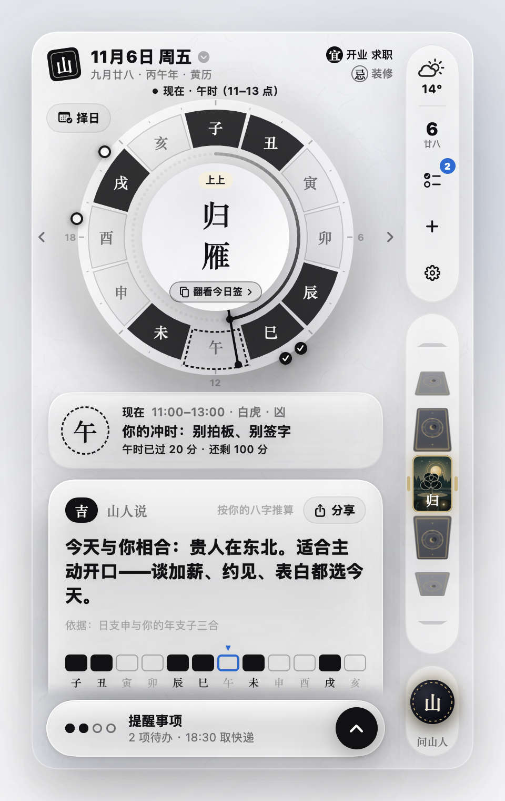
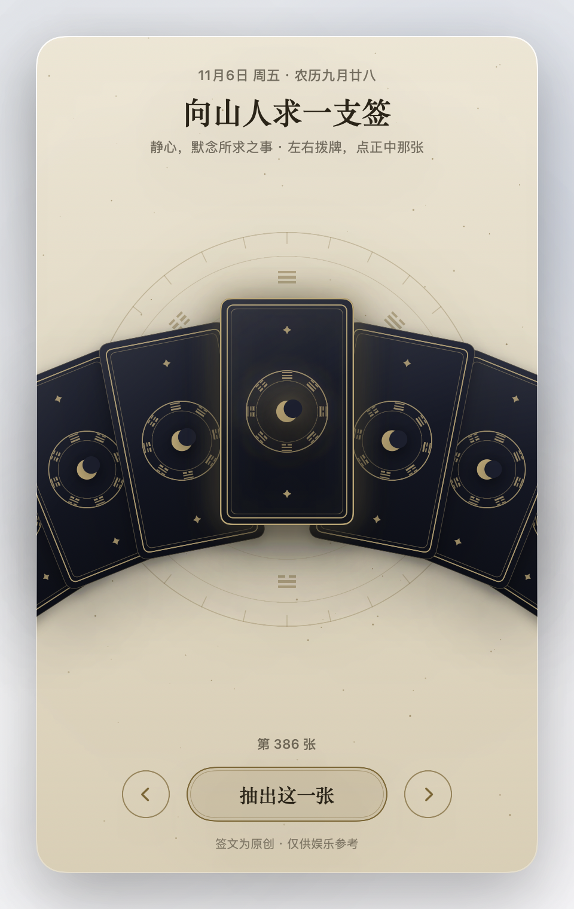
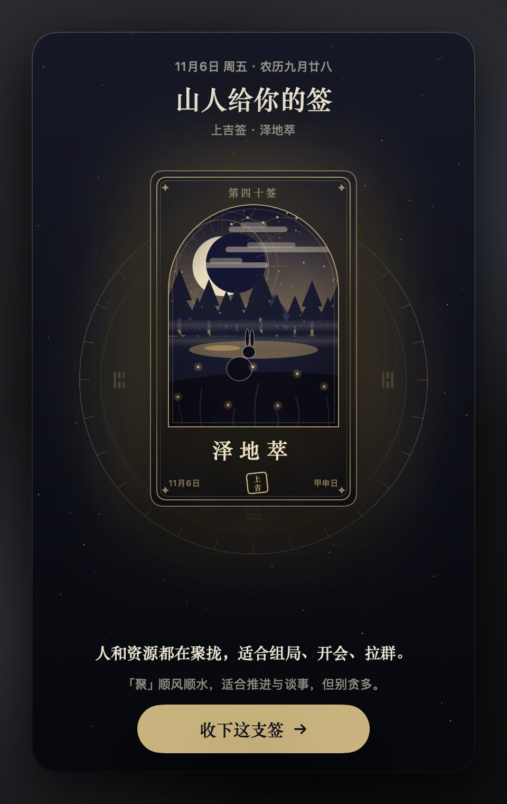
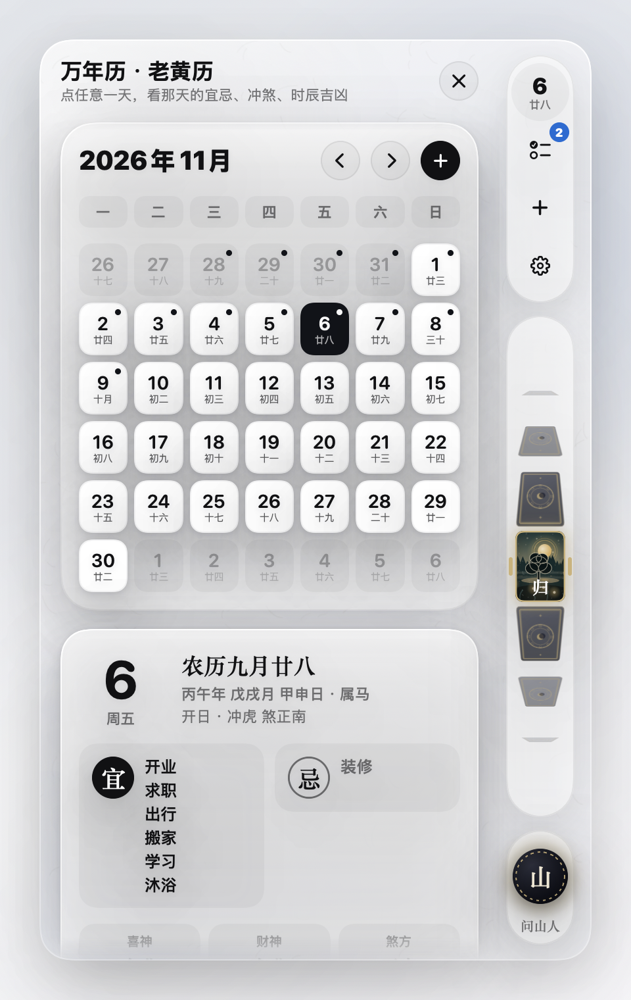
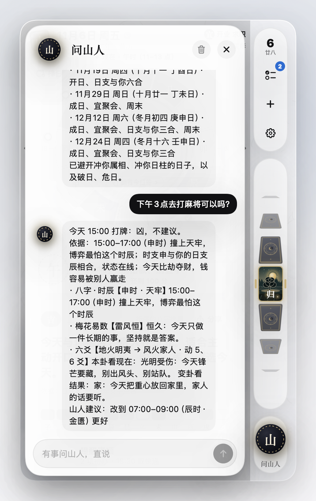

# 今日签 · 山人

**住在 Mac 菜单栏里的隐士高人。** 每天递你一支签，把一天摊成一只十二时辰轮：哪个时辰吉、哪个时辰凶，今天的事排在哪，一眼看清；有事就「问山人」。

*A macOS menu-bar app: a hermit sage hands you a daily fortune slip, shows your day as a 12-shichen dial (auspicious / inauspicious hours from your birth chart and the Chinese almanac), and answers your questions. All calculations run locally. For entertainment only.*

> 签文原创 · 黄历本地推算 · 生辰只存本机 · AI 可选且默认关闭 · **仅供娱乐参考** · MIT

## 能做什么

| 功能 | 说明 |
|---|---|
| 每日求签 | 夜色星图、扇形牌阵，左右拨牌、抽出、翻开。88 支签（原创 24 支 + 六十四卦签 64 支），每支签一幅程序生成的原创签图 |
| 十二时辰轮 | 按你的八字和当天黄历，标出吉时、凶时、冲你的时辰；拨动指针看每个时辰宜做什么；左右切换前后 30 天 |
| 老黄历 | 农历、干支、建除值日、宜忌、冲煞、喜神财神方位、十二时辰吉凶 |
| 命理总批 | 四柱、五行分布、日主强弱、喜用、本命卦、本命四象 |
| 问山人 | 像聊天一样问：「按我的八字，最近哪天适合谈合作？」没接 AI 时用本机算法回答；接了自己的 AI 会更灵活 |
| 待办 | 一句话添加（「明天下午3点 开会」），自动落在时辰轮上，拖动圆点改时间，可同步到系统「提醒事项」 |
| 其他 | 天气（可选）、浅色/深色跟随系统、中英文 |

| 求签 | 翻开 | 老黄历 | 问山人 |
|---|---|---|---|
|  |  |  |  |

## 安装

1. 到 [Releases](../../releases) 下载 `今日签-mac.zip`，解压，把 App 拖进「应用程序」。
2. 第一次打开如果提示「无法验证开发者」：**右键 App →「打开」→ 再点「打开」**（本项目没有付费做苹果公证）。
3. 菜单栏会出现一只小表盘。先报上生辰，再求今天的签。

需要 macOS 13 或更高，Apple 芯片和 Intel 都支持。

## 接入 AI（可选）

设置 → AI：选服务商（DeepSeek / Kimi / 通义千问 / 智谱 GLM / 硅基流动 / OpenAI / 自定义）→ 粘贴你自己的密钥 → 点「连接」。本应用**不内置任何 AI 服务和密钥**，密钥只存在你 Mac 的钥匙串里。

## 隐私

- 没有服务器，开发者收不到任何数据。生辰、待办、聊天都存在 `~/Library/Application Support/` 下。
- 默认完全不联网。打开天气才会连接 [Open-Meteo](https://open-meteo.com/)（定位失败时用 ipwho.is 按网络大致定位）。
- 接了 AI 后，问山人时会把你的问题、四柱八字和推算结论发给**你自己选的那一家**，不发送出生日期。注意：四柱八字本身仍属于个人信息。

## 自己编译

装好 Xcode 或命令行工具（`xcode-select --install`），双击 `构建新版.command`。会编译出 Universal 版本到 `dist/`，并跑自检、生成截图。纯 SwiftUI + AppKit，无第三方依赖。

## 说明与致谢

推算依据来自中国传统术数中的公有领域知识：子平八字、建除十二神、黄道黑道十二神、梅花易数、六爻、小六壬，以及塔罗大阿卡纳的牌名。所有算法与文字均为本项目原创实现，未使用第三方命理库；签文与断语均为原创，未摘录任何寺庙签文。农历日期使用 macOS 系统日历。天气数据由 [Open-Meteo.com](https://open-meteo.com/) 提供（CC BY 4.0）。

所有结果**仅供娱乐参考**，不构成任何医疗、投资、法律或人生决策建议。

## 许可

[MIT](LICENSE)
