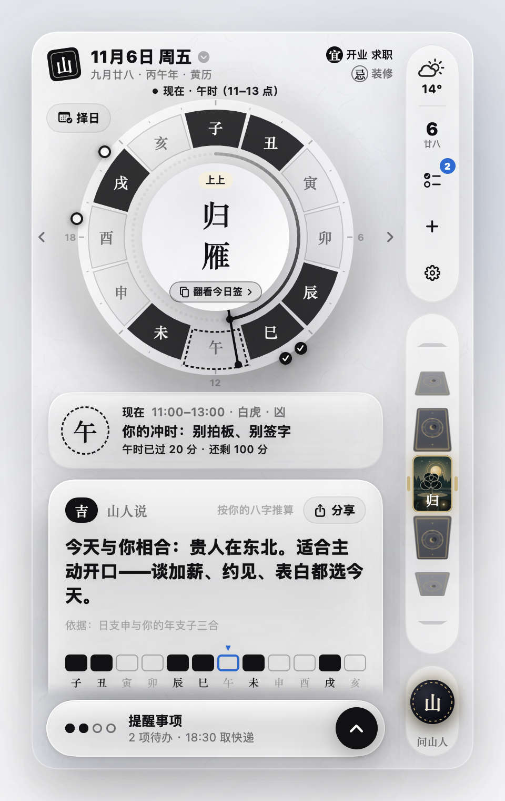

# 今日签 · 山人（新版）使用说明

> 设定：有一位隐居山中的先生「山人」替你看日子。他每天递你一支签，把一天摊成一只**时辰轮**给你看；你有事就上山**问山人**；你做完一件事，他在上面盖个「毕」字。仅供娱乐参考。

构建后软件在 `dist/今日签.app`（或直接用 `~/创作/今日签/01-软件/` 里现成的）。数据存在 `~/Library/Application Support/今日签-山人/`。

## 一、安装

| 步骤 | 操作 |
|---|---|
| 1 | 打开 `dist`（或 `01-软件`），双击 **今日签.app**（想长期用就拖进「应用程序」） |
| 2 | 若提示“无法验证开发者”：右键 →「打开」→ 再点「打开」 |
| 3 | 菜单栏出现一个**小表盘**图标：实心扇形 = 现在所在的时辰；圆心是大实心点 = 今天还没求签 |
| 4 | 第一次打开先**报生辰**（年月日时四个滚轮），之后才求签——签、吉凶时辰、问事、命理总批都按它推算 |

## 一点五、求签

夜色星图上，一只八卦星盘缓缓转动，一叠签牌扇形展开（牌背是八卦环与新月）。两指左右滑或点两侧箭头拨牌，每拨一张触控板轻震；点正中那张抽出、翻面，签面是旧纸黄铜框。浅色模式是旧书纸底，深色模式是夜空底。

## 一点八、右侧侧边栏（任何页面都在）

| 从上到下 | 点一下 |
|---|---|
| 天气（图标会动） | 弹出天气详情（需在设置里打开天气） |
| 日期 | 打开万年历 · 老黄历 |
| 提醒（蓝点 = 未完成数） | 从底部弹出今日提醒 |
| ＋ | 新建待办（闹钟式） |
| 齿轮 | 设置（再点一次回首页） |
| 签条 | 正中是今天的签（水墨签图）。上下拨会翻过一张张签牌，有 3D 翻动和轻震，松手总会弹回今天这一支；点它看签与命理总批 |
| 山人（墨珠） | 从右边滑出「问山人」对话，任何页面都能问 |

## 二、首页：时辰轮

| 看什么 | 意思 |
|---|---|
| 外圈 12 格 | 十二时辰，0 点（子时）在正上方，顺时针走一天。**实心 = 吉时，空心 = 凶时，蓝色虚线 = 你的冲时** |
| 黑色指针 | 现在 |
| 外圈小圆点 | 今天带时间的待办：实心打勾 = 已做，空心蓝圈 = 未做 |
| 圆心 | 今天的签（签名竖排），下面写着「看签 · 命理总批」，点一下打开 |
| 顶部日期 | 点一下打开**万年历 · 老黄历**：任意一天的农历、干支、建除、冲煞、喜神财神方位、宜忌、十二时辰吉凶 |
| 下面一行卡片 | 指针 / 拨到的那个时辰：几点到几点、吉凶、宜做什么或别做什么、这个时辰里有哪些待办 |
| 「山人说」 | 今天最重要的一句断语；点开「山人细说」看全部：十二时辰、今天就去做 / 千万别、方位、今日一卦、签文宜忌 |
| 底部胶囊 | 今日提醒；点开可新建待办、看全部日程、择日 |

| 怎么玩 | 效果 |
|---|---|
| 两指旋转 / 两指上下滑 | 拨动时辰（5 分钟一格），每跨过一个时辰触控板会轻轻「咔」一下 |
| 在外圈上按住拖动 | 同上，直接把蓝色指针拖到想看的时间 |
| **按住某个待办圆点沿圈拖** | 改这件事的时间，松手即保存（也会同步到系统「提醒事项」） |
| 两指左右滑 / 两侧小箭头 | 翻到前一天、后一天（前后各 30 天）；过去的日子圆心显示那天抽的签 |
| 卡片右边的 ↩ | 回到「今天 · 现在」 |

## 三、问山人

点右上角**山形**图标。直接问一件事，比如「下午3点去打麻将可以吗？」。山人会先**掷三枚铜钱**，再给结论：

| 部分 | 内容 |
|---|---|
| 方印 | 大吉 / 吉 / 平 / 凶 / **慎** |
| 多角度合参 | 八字·时辰、梅花易数、六爻、小六壬、塔罗，各给一句 |
| 为什么 / 破解办法 | 依据和怎么补救、改到几点更好 |

**钱、病、官司**（买基金、做手术、打官司之类）山人一律只说「慎」，并提醒以专业人士意见为准——他只看时辰，不替你拿主意。

## 三点二、问山人（对话）

像聊天一样直接问，可以追问。比如「按我的八字，今年适合结婚的日子有哪些？」「下午 3 点去打麻将可以吗？」。

| 接了 AI | 没接 AI |
|---|---|
| 本机先算好你的命盘（四柱、五行、喜用、本命卦，不含出生日期）、今天的黄历与十二时辰，以及这个问题需要的推算（择日候选 / 某个时辰的起课），作为「山人的笔记」交给你接的模型，由它灵活作答 | 山人用本机算法直接答：问日子就列出避开冲日、破日、危日后的好日子；问某个时间做某事就给吉凶与多法合参 |

## 三点三、签库

原创 24 支 + 周易六十四卦签 64 支，共 88 支；每次还按抽中的那张牌显示「动爻」，变化更多。每支签都有一幅程序生成的原创水墨签图（远山、日月、江舟、松、归鸟，右上角是本签卦纹）。

## 三点五、看签 · 命理总批

点圆心打开。上面是今天的签（签诗、解签、今日一事），下面是**命理总批**：四柱、五行分布（蓝色为喜用）、日主强弱、本命卦、本命四象，以及山人的五句批语。接了 AI 后可点「让 AI 细批一生」——只发送四柱和推算结论，**不发送出生日期**。

## 三点六、AI 三步接入

设置 → AI：① 点选服务商（DeepSeek / Kimi / 通义千问 / 智谱 GLM / 硅基流动 / OpenAI / 自定义）→ ② 粘贴密钥（旁边有「去拿密钥」链接）→ ③ 点「连接」。地址自动填、模型列表自动拉取并自动选好、自动测试，成功即保存。想换模型点一下模型名，会自动重新测试。

## 四、待办

| 操作 | 说明 |
|---|---|
| 新建 | 底部胶囊 →「新建待办」：像设闹钟一样拨时、分，选日子，写事项 |
| 完成 | 点一下，右侧「啪」地盖一个「毕」字印章 |
| 改时间 | 首页拖时辰轮上的圆点 |
| 全部日程 / 择日 | 在底部胶囊展开的面板里 |

## 五、和旧版比，变了什么

| 旧版 | 新版 |
|---|---|
| 首页一长条卡片要往下滚 | 一屏一只时辰轮，什么时候好、什么时候坏、事情排在哪，一眼看完 |
| 吊牌 + 日期条 + 断语卡 + 签卡 | 合进时辰轮和「山人说」，细节放到「山人细说」 |
| 问事 | 问山人：掷钱仪式 + 方印；钱病官司只说「慎」 |
| 便签、日历、签册 | 去掉入口；回看过去的签改为在时辰轮上左右翻天 |
| 菜单栏是签牌 | 菜单栏是一只小表盘，随时辰走 |

设置（生辰、AI、天气、提醒、语言）和旧版一样。签文原创，黄历由传统算法在本机推算，**仅供娱乐参考**。MIT 协议。
